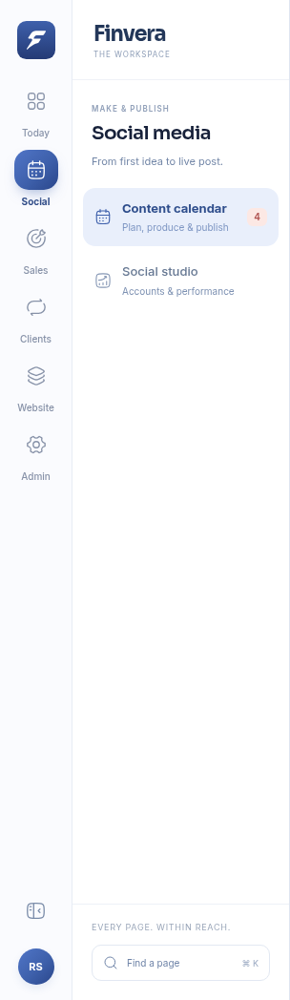
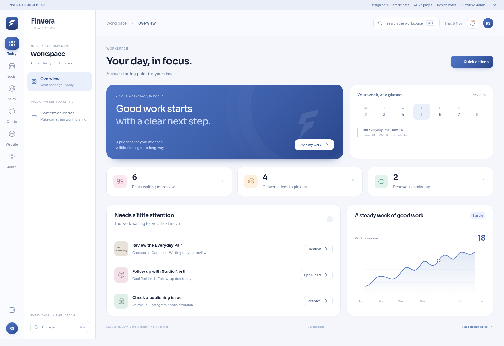

# Finvera — Design concept 02

**Design review only.** Application UI and backend behavior are unchanged by this branch. Sample content is shown in every preview.

This direction keeps Finvera’s actual mark, Sora/Inter fonts, Hugeicons, blue gradients and stage colours. A compact workspace rail and focused page list organize all 27 existing dashboard routes.

## Open the designs

- [Open the PDF design book](Finvera-Concept-02-Design-Book.pdf)
- [Download the complete interactive design package](Finvera-Concept-02.zip?raw=true)

For the interactive version, download and extract the ZIP, then open `index.html` in your browser. It works offline and makes no live application requests.

## Sidebar

[Mobile navigation](screenshots/sidebar-mobile.png) · [Collapsed desktop rail](screenshots/sidebar-collapsed.png)

## Dashboard

## All 27 page designs

| Page | Desktop | Mobile |
|---|---|---|
| Overview | [View](screenshots/overview.png) | [View](screenshots/overview-mobile.png) |
| Content calendar | [View](screenshots/social.png) | [View](screenshots/social-mobile.png) |
| Social studio | [View](screenshots/social-studio.png) | [View](screenshots/social-studio-mobile.png) |
| Leads | [View](screenshots/leads.png) | [View](screenshots/leads-mobile.png) |
| Contact inbox | [View](screenshots/contact.png) | [View](screenshots/contact-mobile.png) |
| Renewals | [View](screenshots/renewals.png) | [View](screenshots/renewals-mobile.png) |
| Website overview | [View](screenshots/content.png) | [View](screenshots/content-mobile.png) |
| Portfolio | [View](screenshots/projects.png) | [View](screenshots/projects-mobile.png) |
| Services | [View](screenshots/services.png) | [View](screenshots/services-mobile.png) |
| Blog | [View](screenshots/blog.png) | [View](screenshots/blog-mobile.png) |
| Website pages | [View](screenshots/pages.png) | [View](screenshots/pages-mobile.png) |
| Website team | [View](screenshots/team.png) | [View](screenshots/team-mobile.png) |
| Testimonials | [View](screenshots/testimonials.png) | [View](screenshots/testimonials-mobile.png) |
| FAQs | [View](screenshots/faqs.png) | [View](screenshots/faqs-mobile.png) |
| Values | [View](screenshots/values.png) | [View](screenshots/values-mobile.png) |
| Brand ecosystem | [View](screenshots/brands.png) | [View](screenshots/brands-mobile.png) |
| Company timeline | [View](screenshots/timeline.png) | [View](screenshots/timeline-mobile.png) |
| Process steps | [View](screenshots/process.png) | [View](screenshots/process-mobile.png) |
| Website stats | [View](screenshots/stats.png) | [View](screenshots/stats-mobile.png) |
| Client logos | [View](screenshots/logos.png) | [View](screenshots/logos-mobile.png) |
| Solution features | [View](screenshots/features.png) | [View](screenshots/features-mobile.png) |
| SEO & sharing | [View](screenshots/seo.png) | [View](screenshots/seo-mobile.png) |
| Users & access | [View](screenshots/users.png) | [View](screenshots/users-mobile.png) |
| Activity log | [View](screenshots/activity.png) | [View](screenshots/activity-mobile.png) |
| Settings & tracking | [View](screenshots/settings.png) | [View](screenshots/settings-mobile.png) |
| System health | [View](screenshots/system.png) | [View](screenshots/system-mobile.png) |
| My account | [View](screenshots/account.png) | [View](screenshots/account-mobile.png) |

## Approval

No implementation agents have been started. UI implementation will begin only after explicit approval of this direction.
