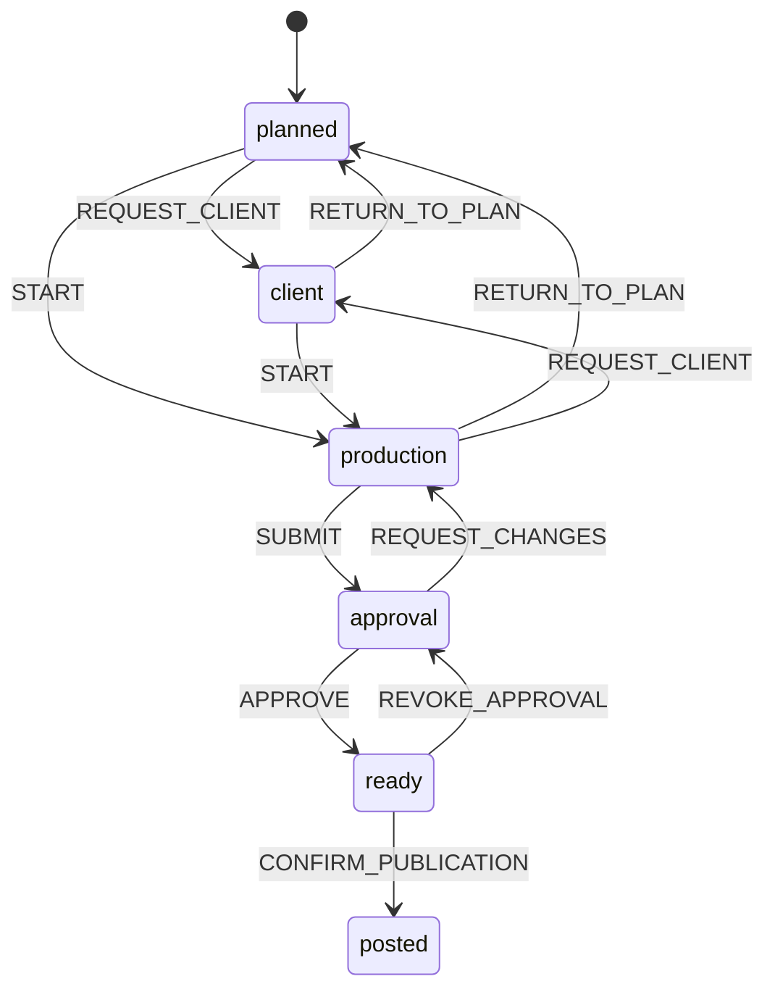

# Explicit state machines

Implementation is sequential. A row is complete only when production handlers
use the extracted rules and the relevant checks pass. Status names, API payloads,
database storage and user permissions are preserved unless a separate behavior
change is documented. Frontend and backend deploy independently; mirrored browser
rules are checked against the server by contract tests.

## Progress

| Order | Machine family | Status |
| --- | --- | --- |
| 1 | Social post lifecycle and format-based ownership | Complete |
| 2 | Publishing job lifecycle, retry and lease recovery | Pending |
| 3 | Approval invalidation and multi-platform completion | Pending |
| 4 | Instagram/Facebook checkpoints and Reel cover retry | Pending |
| 5 | OAuth selection, account health and channel pause | Pending |
| 6 | Account lifecycle, lockout and authentication | Pending |
| 7 | Two-factor enrollment, tickets and backup-code consumption | Pending |
| 8 | Invite/reset links, sessions and required password changes | Pending |
| 9 | CRM pipeline and follow-up deadlines | Pending |
| 10 | Renewal lifecycle and deadlines | Pending |
| 11 | Inbox classification, lead conversion and reply delivery | Pending |
| 12 | CMS publication and report review/revision | Pending |
| 13 | Calendar import, handoff and client-request dialogs | Pending |
| 14 | Saved-post hydration, uploads and review desk | Pending |
| 15 | Editor saving, conflicts, report export and inbox composer | Pending |
| 16 | Public enquiry forms and CAPTCHA | Pending |
| 17 | Data loading, pagination and connectivity | Pending |
| 18 | Push, installation, notifications and read status | Pending |
| 19 | Images, dialogs, navigation and marketing interactions | Pending |
| 20 | Operational tools and server startup | Pending |
| 21 | Schedulers, runner locks and alert claims | Pending |
| 22 | Backup artifacts, studio refresh and shared caches | Pending |
| 23 | WebP queue, repairs, polling and lazy initialization | Pending |
| — | Dormant task-board/timer schemas | Document only; no active workflow to refactor |

## 1. Social posts and ownership

Server definition: `Backendjs/src/utils/socialPostMachine.js`.
Browser definition: `frontend/lib/socialWorkflow.ts`.

The graph expresses possible moves, not authorization to execute them. Server
guards still require an owner before production/review, uploaded artwork before
submission, the assigned reviewer/admin for approval, saved-content preflight,
and verified live links for manual publication. Published content and publishing
jobs retain their existing edit locks. System repair code is deliberately not
routed through normal user transitions.

Ownership is graphic/video maker before review (chosen by format), then social
reviewer. Production normalizes legacy `step` values to that format's maker.
Ready/Posted have no next handoff; confirmation is a separate publishing action.

Verification: backend path/guard regression tests and frontend/API contract tests
cover all 36 stage pairs, named events and format-based ownership; TypeScript
checks the browser integration.
