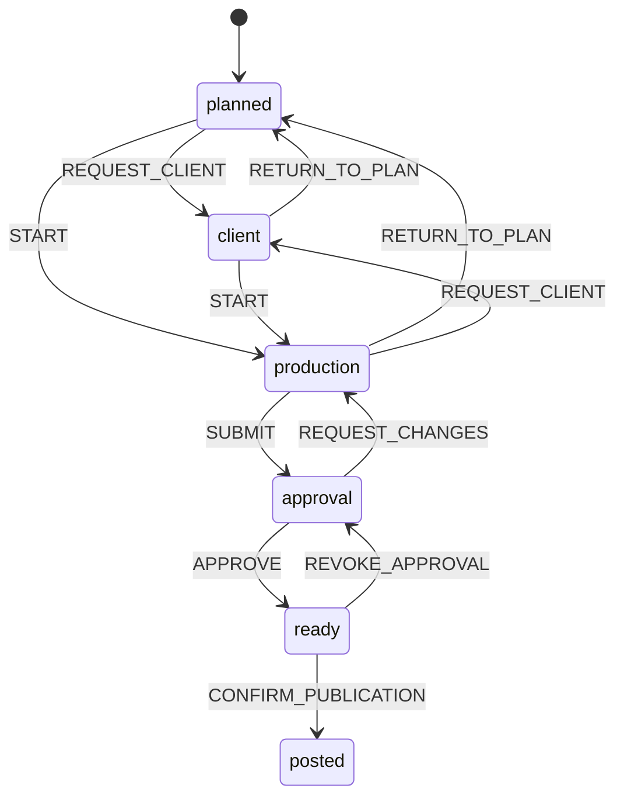

# Explicit state machines

Implementation is sequential. A row is complete only when production handlers
use the extracted rules and the relevant checks pass. Status names, API payloads,
database storage and user permissions are preserved unless a separate behavior
change is documented. Frontend and backend deploy independently; mirrored browser
rules are checked against the server by contract tests.

## Progress

| Order | Machine family | Status |
| --- | --- | --- |
| 1 | Social post lifecycle and format-based ownership | Complete |
| 2 | Publishing job lifecycle, retry and lease recovery | Complete |
| 3 | Approval invalidation and multi-platform completion | Complete |
| 4 | Instagram/Facebook checkpoints and Reel cover retry | Complete |
| 5 | OAuth selection, account health and channel pause | Complete |
| 6 | Account lifecycle, lockout and authentication | Complete |
| 7 | Two-factor enrollment, tickets and backup-code consumption | Complete |
| 8 | Invite/reset links, sessions and required password changes | Complete |
| 9 | CRM pipeline and follow-up deadlines | Complete |
| 10 | Renewal lifecycle and deadlines | Complete |
| 11 | Inbox classification, lead conversion and reply delivery | Complete |
| 12 | CMS publication and report review/revision | Complete |
| 13 | Calendar import, handoff and client-request dialogs | Complete |
| 14 | Saved-post hydration, uploads and review desk | Complete |
| 15 | Editor saving, conflicts, report export and inbox composer | Complete |
| 16 | Public enquiry forms and CAPTCHA | Complete |
| 17 | Data loading, pagination and connectivity | Complete |
| 18 | Push, installation, notifications and read status | Complete |
| 19 | Images, dialogs, navigation and marketing interactions | Complete |
| 20 | Operational tools and server startup | Pending |
| 21 | Schedulers, runner locks and alert claims | Pending |
| 22 | Backup artifacts, studio refresh and shared caches | Pending |
| 23 | WebP queue, repairs, polling and lazy initialization | Pending |
| — | Dormant task-board/timer schemas | Document only; no active workflow to refactor |

## 1. Social posts and ownership

Server definition: `Backendjs/src/utils/socialPostMachine.js`.
Browser definition: `frontend/lib/socialWorkflow.ts`.

The graph expresses possible moves, not authorization to execute them. Server
guards still require an owner before production/review, uploaded artwork before
submission, the assigned reviewer/admin for approval, saved-content preflight,
and verified live links for manual publication. Published content and publishing
jobs retain their existing edit locks. System repair code is deliberately not
routed through normal user transitions.

Ownership is graphic/video maker before review (chosen by format), then social
reviewer. Production normalizes legacy `step` values to that format's maker.
Ready/Posted have no next handoff; confirmation is a separate publishing action.

Verification: backend path/guard regression tests and frontend/API contract tests
cover all 36 stage pairs, named events and format-based ownership; TypeScript
checks the browser integration.

## 2. Publishing jobs

`Backendjs/src/utils/publishJobMachine.js` defines the events consumed by the
publisher, operator actions and cancellation/reconciliation handlers. Worker
completion retains the existing lease-token WHERE clause; event validation is
not a replacement for database ownership. Recovery before a remote write returns
to Scheduled; recovery after a write goes to Check. Only the operator Retry path
can leave Check, after its existing absence/permission checks. Published jobs
cannot be sent through Retry or Publish now. A confirmed Facebook Reel with a
pending cover can resume the cover without creating a second post.

Post settlement distinguishes no intended jobs, pending, partially published and
complete publication. Cancelled jobs do not count as intended results, and an
empty set never counts as complete. Existing platform and operator regressions
plus machine tests cover these paths.

## 3. Review validity

`socialReviewMachine.js` makes Draft, Review, Approved, Publishing and Live
content states explicit. Publishing locks outrank the workflow stage; a remote
write or published/uncertain result makes content Live for editing purposes.
The existing Instagram-only tagging exception remains narrow. Approval
revocation restores the reviewer and is shared by edits and reconciliation.
Content hashing lives in `socialContent.js`, avoiding a dependency cycle between
the review policy and API validation. Multi-platform completion uses the job
machine's None/Pending/Partial/Complete classification from step 2.

## 4. Platform checkpoints

`publishCheckpointMachine.js` records named container/photo/video staging,
upload, remote-write, confirmation and cover events. It exposes Empty, Staged,
Uploaded, Write-started, Cover-pending and Published states. The live mutable
checkpoint object, serialization fields, persistence order and remote calls are
unchanged, so existing interrupted-upload and cover-only retry behavior survives.
Platform regression tests exercise actual publisher functions with fake Meta
responses; checkpoint tests verify retained result IDs and approval fingerprints.

## 5. Social connections

`socialConnectionMachine.js` names OAuth selection eligibility and Connect/Auth
failure events, plus channel pause/resume transitions and target selection. The
controller still consumes the selection row only after saving the connection;
health-check transport failures still do not change connection status. Channel
updates retain the existing row lock and subsequent job synchronization. Tests
cover selection ownership/expiry, empty explicit target lists and independent
pause/resume behavior.

## 6. Account state and lockout

`accountMachine.js` separates account display status from lockout eligibility and
the post-password authentication step. The five-attempt/15-minute thresholds,
strict failure-window boundary, automatic lock expiry and display precedence are
unchanged. Login, password reset and admin unlock use the same reset event.
Password hashing, session creation and audit/notification effects stay in the
controllers. Boundary tests cover the fifth failure, expiry and invitation/lock
overlap.

## 7. Second factor

`secondFactorMachine.js` names Disabled/Setup/Enabled configuration and the Setup,
Enable, Disable and Renew-codes patches. It encapsulates TOTP-step and login-ticket
consumption and backup-hash removal; password/code verification and durable writes
stay in existing handlers. Replay tracking remains process-local, preserving the
existing deployment semantics rather than silently introducing a new datastore.

## 8. Credentials and sessions

`credentialMachine.js` centralizes single-use link eligibility, session rejection,
revocation patches and password-change/reset effects. JWT verification remains
the expiry authority before session-row checks. Reset versus administrator-set
password events intentionally differ in whether they clear a required password
change. Atomic link consumption, session writes and cache invalidation remain in
their existing locations. Tests cover consumed/expired links, legacy cutoffs,
cross-user sessions and credential side effects.

## 9. Leads

`leadMachine.js` owns stage scores, win timestamps and follow-up deadline states.
The model's existing changed-field hooks consume those rules, preserving direct
stage jumps, manual timestamp overrides and legacy field synchronization. Open
follow-up queries use the same classification. Tests cover leaving/reentering
Won and time moving a follow-up through Future/Today/Overdue; Won/Lost suppress
follow-up states.

## 10. Renewals

`renewalMachine.js` owns Renew/End/Restore/Remark effects, billing-cycle date
advancement and deadline/reminder eligibility. Renewal actions retain row locking,
expected-value conflicts and note/audit effects. Reminders still fire only at the
existing 7/1/0/-1-day offsets, not on every approaching/overdue day. Existing
month-end/leap-year tests and new lifecycle/reminder tests cover the extraction.

## 11. Inbox

`inboxMachine.js` makes read/spam classification, lead conversion eligibility and
mail-delivery outcomes explicit. Read and spam flags remain independent in storage;
restoring spam still makes a message unread. Conversion retains its transaction,
existing-link reuse and deleted-lead recovery. Unconfigured mail differs from a
failed attempted delivery, preserving existing reply-history and HTTP behavior.

## 12. Content and report review

`contentMachine.js` owns publication state validation used by all editable content
controllers and public detail visibility used by shared CRUD. Collection-specific
publication requirements stay in their validators. Report revision effects now
explicitly distinguish commentary edits (Draft) from an explicit Review action
(Reviewed), without changing immutable snapshot data or optimistic version checks.
Content/public-draft regressions and report-revision tests verify these rules.

## 13. Calendar dialogs

`dialogMachine.ts`/`useWorkflowDialog.ts` represent Closed/Editing/Submitting
dialogs explicitly. Handoff and client-input dialogs consume that state through
their existing setter interface, preserving validation and error text. Import
uses a single Closed/Brand/Team/Importing union, so brand and team dialogs cannot
be active together. Cancellation/retry tests cover selected-person retention and
functional state updates; CI runs the UI workflow tests.

## 14. Saved artwork and review UI

`socialWorkMachine.ts` owns light-to-full editor hydration (retaining dirty fields
and version timestamps), artwork upload eligibility and review-desk readiness.
Read-only, disabled, uploading, cover-saving and full upload states are explicit;
review has loading/checking/error/blocked/checklist/ready/submitting states.
Existing per-post mutation locks and saved-version preflight identity checks stay
in place. Tests exercise late hydration and every condition blocking approval.

## 15. Saving and conflicts

`editorMachine.ts`/`useSaveWorkflow.ts` model save activity separately from its
None/Error/Conflict outcome, preserving errors through asynchronous cleanup.
Portfolio/blog/page/SEO, lead/renewal and collection editors consume it, as does
the inbox composer. Draft comparisons, upload counters and expected-version
payloads remain unchanged. Report export explicitly chooses Create/Update/Read
before preparing files; its existing operation lock and popup lifecycle remain.

## 16. Public enquiries

`enquiryMachine.ts` supplies submission events shared by the contact form and
consultation panel. Success survives asynchronous cleanup until reset. CAPTCHA
loading/token/expiry/error/reset/removal states live in the existing ref rather
than causing renders; widget lifecycle and server validation stay unchanged.
Tests cover success cleanup and expired-token clearing.

## 17. Resources and paging

`resourceMachine.ts`/`useResourceState.ts` name unloaded/loading/refreshing/ready/
empty/error/stale-error states and independent load-more activity. Collection
lists, Today/My work, resource manager, inbox/activity pagination and KPI/report
widgets use the shared state. Existing data survives refresh errors. Overlapping
pagination/refresh flags are preserved rather than one completion ending both.
Backend connectivity uses an explicit result classifier. No request cancellation
or stale-response policy is changed in this extraction.

## 18. Notifications and installation

Browser notification eligibility, subscription Create/Reuse/Replace actions and
Installed/Prompt/Instructions/Unavailable states are named in
`notificationMachine.ts`. Read events are shared by bell actions. The backend
notification machine classifies delivered/expired/failed push responses and read
patches; only expired subscriptions are removed. Service-worker visibility selects
Quiet/Audible delivery while native install/activate events remain native.

## 19. Presentation and disclosure

`presentationMachine.ts`/`useDisclosure.ts` name Open/Closed events used by dropdowns,
pickers, navigation, the bell, reports/history and the cookie prompt. Selected
tabs/options remain their existing explicit values. Image Loading/Ready/Fail
events retain generation/source guards; dialog confirm/cancel results share a
pure resolver. Marketing reveal policy keeps one-way reveals visible. Native
animation/preloader events and existing DOM class/timer effects remain in their
components. Tests cover toggling, one-way reveals and prompt/confirm/alert results.
